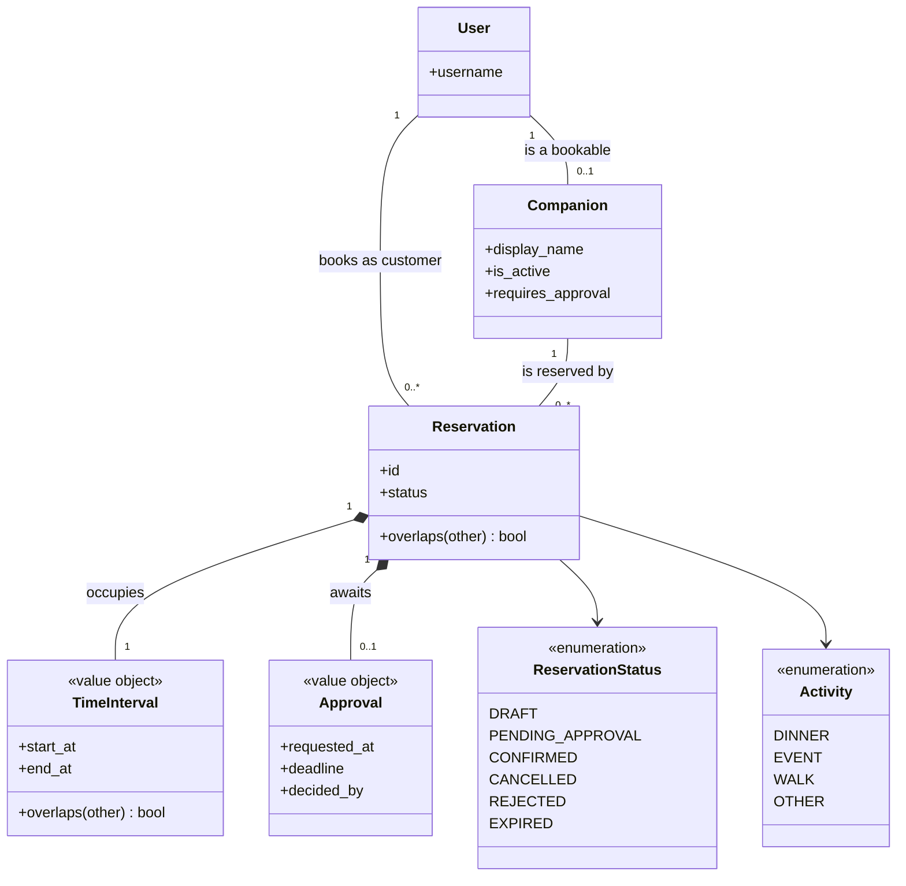
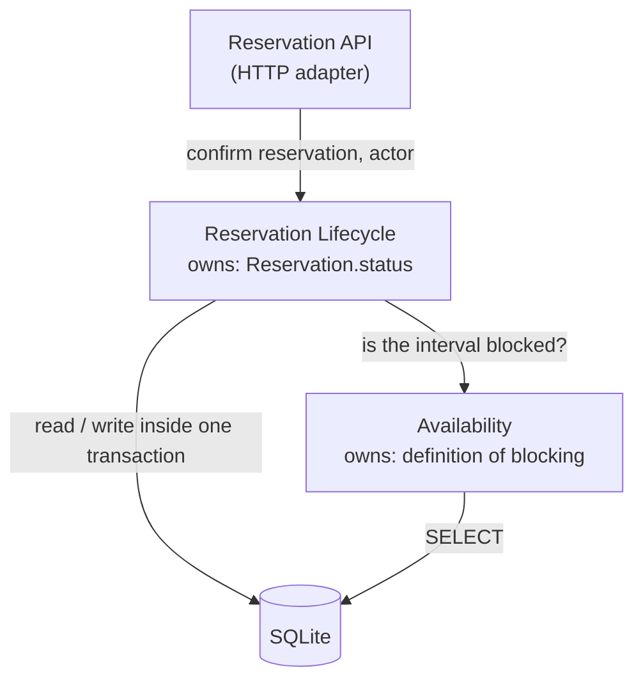
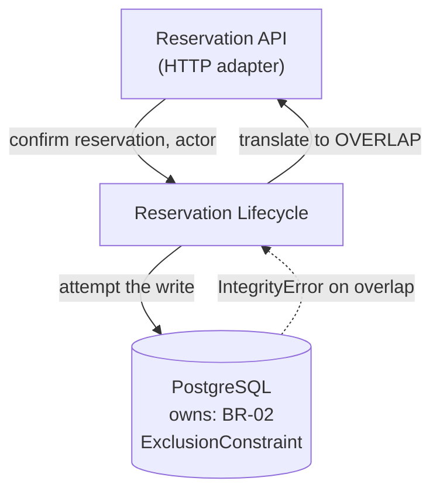
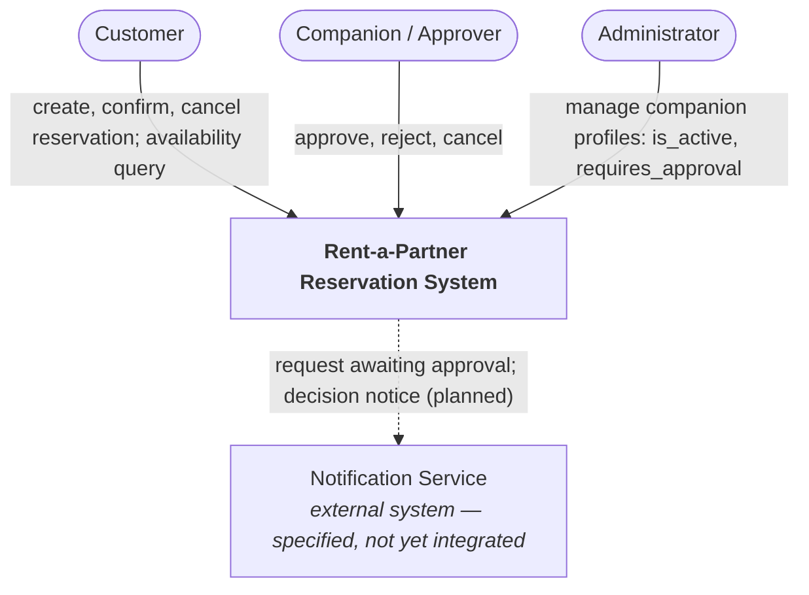
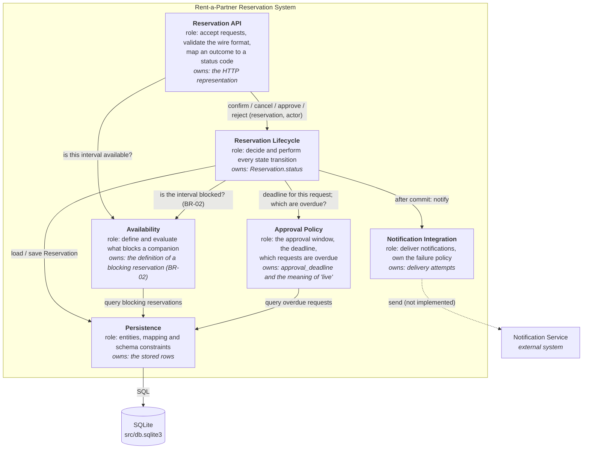
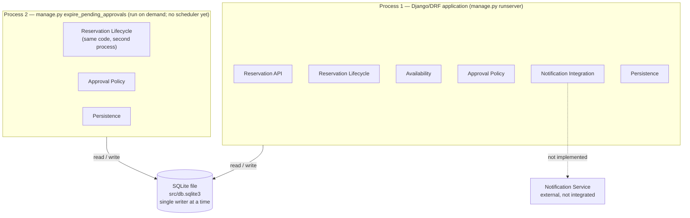
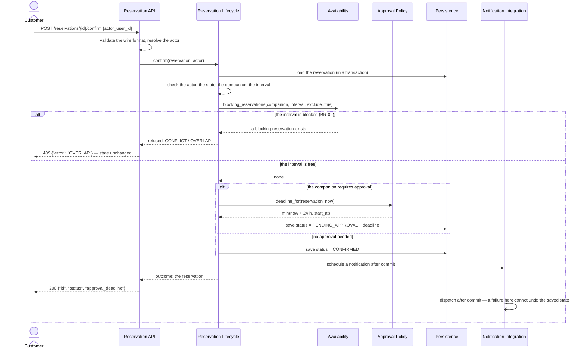
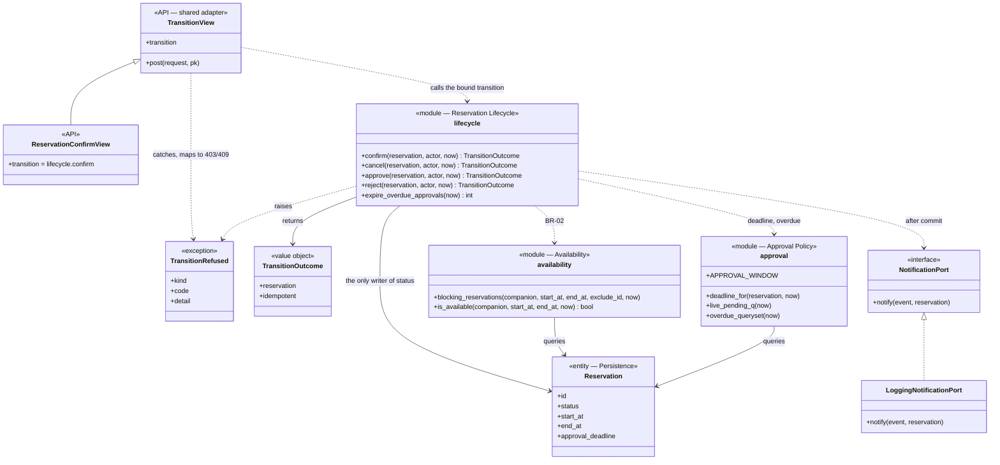
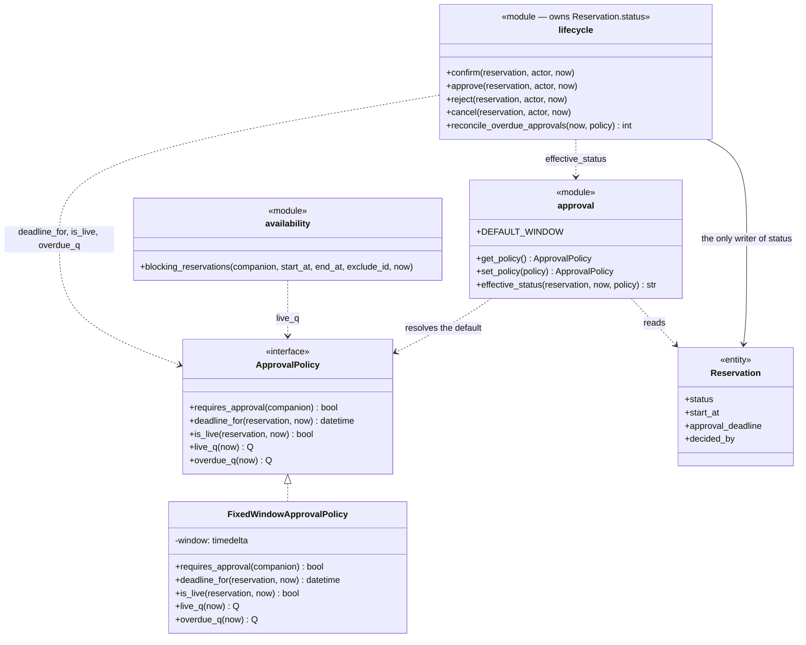
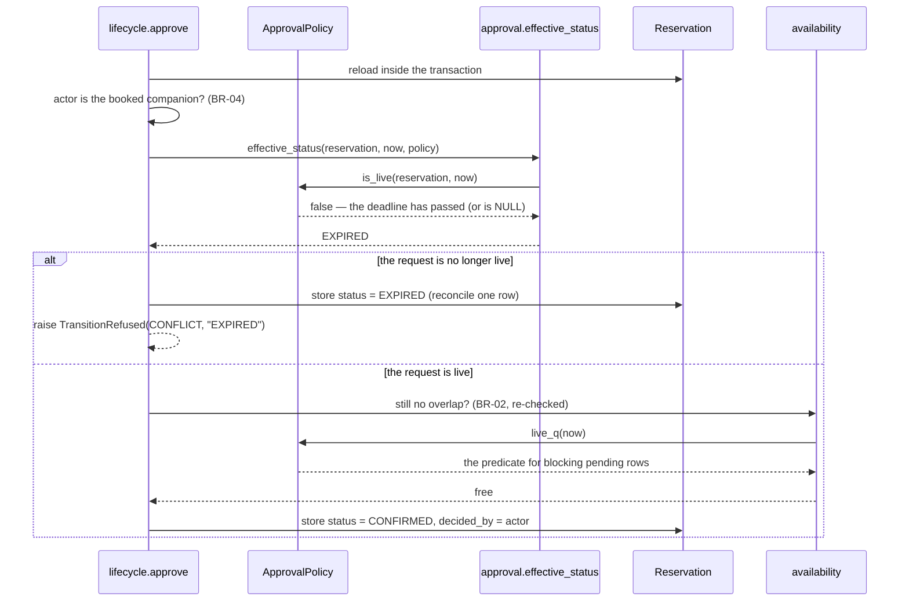

# Architecture and Decisions

## Tech stack

| Area | Choice |
|---|---|
| Language | Python 3.10+ (tested on 3.10 and 3.12) |
| Web framework | Django 5.2 LTS |
| REST API | Django REST Framework (DRF) |
| Database | SQLite (file `src/db.sqlite3`) |
| Tests | pytest + pytest-django |
| Dependencies / build | `pip` + `requirements.txt` in a local `.venv` |

### Justification
- **Django** has everything a small reservation system needs out of the box: ORM, schema migrations, an admin UI for managing companions and reservations by hand, and a mature test client. 5.2 is an LTS release (supported until April 2028), which covers the whole semester.
- **DRF** serializers give us declarative input validation and consistent `400` error bodies. This is exactly the "validate" step of the walking skeleton. Business rules (overlap, approval) will live in the serializer / domain layer instead of being scattered through views.
- **SQLite** needs no installation, so every team member can run the project from a clean checkout with only Python. It is a real SQL database with transactions and constraints, which is enough for CP1 and spike A. Known limit: a single writer at a time. See D3.
- **pytest + pytest-django** allow short tests with fixtures; every test gets its own isolated test database.
- **Team support:** the team works in Python; the whole stack is installed with a single `pip install -r requirements.txt`. We maintain the stack ourselves and the build/run steps live in the README.

## Components

Restructured in C03 along ADR-01; the logical view is [G2](#g2--to-be-static-architecture).

```
HTTP client
   │  POST /reservations · GET /companions/{id}/availability
   │  POST /reservations/{id}/confirm | cancel | approve | reject
   ▼
config/urls.py ──► reservations/urls.py
   ▼
views.py + serializers.py   ← API adapter: wire format, actor, outcome → HTTP status
   ▼
lifecycle.py                ← owns every Reservation.status transition (ADR-01)
   │         │         │
   │         │         └─► notifications.py  ← port, dispatched after commit
   │         └───────────► approval.py       ← the 24 h window and the deadline
   └─────────────────────► availability.py   ← the single definition of BR-02
   ▼
models.py                   ← entities and schema constraints
   ▼
SQLite (src/db.sqlite3)

manage.py expire_pending_approvals   ← second process; delegates to lifecycle.py
Notification Service                 ← external boundary, stub only (see notifications.py)
scripts/check_architecture.py        ← repeatable check of the ADR-01 rule
```

- **config** — Django project: settings, root URLs, WSGI/ASGI.
- **reservations** — the single domain app: entities (`Companion`, `Reservation`, `ReservationStatus`), the lifecycle owner, the availability and approval policies, the notification port, the API views and serializers, admin registration, tests.
- **User** — Django's built-in `auth.User`; used for both customers and the companion's account.
- **Notification Service** — the external boundary from the Project Frame. Since C03 it sits behind `NotificationPort` in `notifications.py`, dispatched after commit so a delivery failure cannot roll back a business decision; the shipped implementation only logs.

## Decisions

### D1 — Reserved resource: Companion
- **Context:** The system type is fixed (reservation system); the team chooses the reserved resource.
- **Decision:** Reserve a companion for a time-boxed social activity.
- **Consequences:** The resource is a person with a user account (`Companion.user`), so they can take part in the workflow themselves (approving reservations). This is why the domain-specific rule is "only the companion confirms". A companion can be deactivated (`is_active`), and then cannot be booked.

### D2 — Django + Django REST Framework
- **Context:** Any stack is allowed; the team must support it and justify it.
- **Decision:** Python 3.10+, Django 5.2 LTS, DRF for the REST API.
- **Consequences:** Migrations and admin come for free; validation in DRF serializers. We are tied to Django's ORM and conventions (apps, `manage.py`).

### D3 — SQLite as the database for now
- **Context:** CP1 and spike A need a real database; we want zero setup for the team.
- **Decision:** SQLite via Django's default backend. No DB-specific SQL; everything goes through the ORM and migrations.
- **Consequences:** Runs immediately from a clean checkout. SQLite allows only one writer at a time and does not support `select_for_update` row locking, so enforcing the overlap rule under concurrent confirmations will be weak. If concurrent confirmations become a real concern (outside our selected C01 pressure, which is C), the plan is to move to PostgreSQL (a settings change plus re-running migrations). **Superseded by [ADR-01](#adr-01--where-the-authoritative-confirmation-decision-is-made-and-what-enforces-br-02-under-concurrency):** that move is no longer tied to a future pressure but to ADR-01's explicit reconsider-when triggers.

### D4 — pytest + pytest-django for automated checks
- **Context:** The walking skeleton needs an automated check.
- **Decision:** pytest with pytest-django; tests live in `src/reservations/tests/`; configuration in `pytest.ini`.
- **Consequences:** `pytest` from the repo root runs everything. Each test runs in a transaction against an isolated test DB.

### D5 — UUID as the reservation ID
- **Context:** `POST /reservations` returns the reservation ID to the client.
- **Decision:** `Reservation.id` is a UUID4 generated by the application.
- **Consequences:** IDs are not guessable or enumerable (a sequential ID would leak how many bookings exist); the ID is known before insert. Slightly bigger index than an integer, which does not matter at our scale.

### D6 — No authentication in CP1
- **Context:** CP1 is about the end-to-end path, not about identity.
- **Decision:** DRF authentication disabled (`AllowAny`); the client sends `customer_id` in the request body.
- **Consequences:** Anyone can create a reservation on behalf of any user. This is acceptable only for the walking skeleton. The rule "only the booked companion can confirm" (step after CP1) needs authentication, so authentication must be added before the confirm operation is implemented. `customer_id` will then come from the logged-in user.

### D7 — The actor is passed in the request body
- **Context:** Confirm, Cancel, Approve and Reject need to know who is acting (BR-06, spec REQ-03/05/09). There is no authentication (D6).
- **Decision:** Every state-changing operation takes `actor_user_id` in the JSON body; the system compares it against the reservation's customer or the booked companion's user.
- **Consequences:** The actor rules are verifiable by tests and by curl without a login, so baseline v0.2 can be demonstrated. Anyone can claim any identity, so this must not reach production. Real authentication changes all four operations — a driver for C03.

### D8 — A pending approval blocks availability
- **Context:** Change C02 introduced `PENDING_APPROVAL`. It had to be decided whether such a reservation blocks the companion (spec REQ-08).
- **Decision:** It blocks while `approval_deadline` has not passed. So the set of blocking states in BR-02 is {`CONFIRMED`, live `PENDING_APPROVAL`}.
- **Consequences:** The system never promises one slot to two customers, at the cost of a slot being held by an undecided request until the deadline. The overlap check therefore also applies at the confirmation request, not only at approval.

### D9 — The deadline is data; expiry only materialises the state
- **Context:** `EXPIRED` is a state change with no user behind it. A background process may not have run.
- **Decision:** `approval_deadline` is stored on the reservation and every availability and overlap query counts a pending reservation as blocking only while the deadline is live. The `expire_pending_approvals` command writes the `EXPIRED` state afterwards.
- **Consequences:** Availability is correct even without a scheduler; the state in the DB may lag behind the real meaning for a while (a stale `PENDING_APPROVAL` row). Two sources of truth about the same fact are a smell — C03 has to decide on a scheduler, a read-time evaluation, or both with a defined relationship.

## Architectural drivers for C03
> **Superseded by [C03 section B](#b--architecture-drivers-refined).** The five drivers below are the raw list
> carried out of C02. Section B refines them against the Part A evidence and is the version to read.

1. **Concurrency around BR-02** — REQ-04 and REQ-09 are business requirements about parallelism; SQLite cannot lock rows (D3), so today it is verified only sequentially. A real guarantee needs PostgreSQL with `select_for_update` or a DB exclusion constraint.
2. **A time-driven process** — expiry (D9) has no actor; it needs a scheduler or read-time evaluation with a clear relationship to the stored state.
3. **The notification boundary** — four operations want to notify, and a notification failure must not roll back the state change. It needs an interface, a stub and a failure policy.
4. **Rules inside views** — the checks for BR-02, BR-03 and BR-04 and the actor rules are repeated across four views in `views.py`. Extracting a domain layer where one state transition = one function is the main refactoring for C03.
5. **The actor's identity** — `actor_user_id` (D7) is a stand-in for authentication and affects every state-changing operation.

---

# C03 Part A — AS-IS mapping of one scenario

This part records **how the code works today**, not how it should be structured. Every claim below was
verified against the source, a test, or a captured runtime trace on 2026-10-15 (tag `v0.2`, commit
`f764c83`, Python 3.10.12). Line numbers refer to that commit.

## A1 — The scenario under study

| Item | Value |
|---|---|
| Scenario / operation | **OP-03 Confirm Reservation** ([specification.md](specification.md)) |
| Requirements | `REQ-03` (conditions for confirmation), `REQ-04` (at most one of two conflicting confirmations), `REQ-07` (a companion requiring approval ends in `PENDING_APPROVAL`) |
| Rules / invariants | `BR-02` (exclusive companion), `BR-01` (half-open intervals), `BR-05` (server clock), `BR-06` (actor identification) |
| Baseline | `v0.2` |

Confirm was chosen over the approval scenario because it is the only operation that runs through the
whole chain — HTTP routing, input validation, all the guard conditions, the `BR-02` query, the state
change and the write — and because both of its branches (success and `409 OVERLAP`) are the ones
`BR-02` depends on.

## A2 — The main success path mapped to code

Steps are the main success scenario of OP-03. Framework plumbing and getters are left out.

| Scenario step (C02) | Implementation | Evidence |
|---|---|---|
| accept the confirmation request | `ReservationConfirmView.post()` | `src/reservations/views.py:77-78`; route `reservations/urls.py:14-18`, mounted by `config/urls.py:6` |
| identify the actor (BR-06) | `actor_or_error()` → `ActorSerializer` | `views.py:79`, `views.py:39-42`, `serializers.py:46-47`; trace: the `auth_user` SELECT runs **before** `BEGIN` |
| load the `Reservation` | `get_object_or_404(Reservation, pk=pk)` | `views.py:81`, inside the transaction opened at `views.py:80` |
| verify the actor is the customer | `reservation.customer_id != actor.pk` → `403` | `views.py:82-85`; test `tests/test_confirm.py:58` |
| verify the transition is allowed | `reservation.status != ReservationStatus.DRAFT` → `409` | `views.py:86-87`; test `tests/test_confirm.py:70` |
| verify the companion is bookable | `reservation.companion.is_active` → `409` | `views.py:88-89`; test `tests/test_confirm.py:122` |
| verify the interval has not started (BR-05) | `reservation.start_at <= now` → `409` | `views.py:91-93`; test `tests/test_confirm.py:134` |
| evaluate the conflict (BR-02) | `blocking_reservations(...).exists()` | `views.py:94-101` calling `models.py:75-86`; test `tests/test_confirm.py:80` |
| decide the target state (REQ-07) | `companion.requires_approval` → `PENDING_APPROVAL` + deadline, else `CONFIRMED` | `views.py:103-108`; tests `tests/test_confirm.py:31` and `:45` |
| change the state | assignment to `reservation.status` | `views.py:104` / `views.py:108` |
| persist the result | `reservation.save()` inside `transaction.atomic()` | `views.py:109`; trace: a single `UPDATE` between `BEGIN` and `COMMIT` |
| return the outcome | `Response(reservation_state(reservation))` → `200` | `views.py:111`, `views.py:31-36` |

**Captured runtime trace of the happy path** (`django.test.utils.CaptureQueriesContext`, `DRAFT → CONFIRMED`,
`HTTP 200 {"id": "...", "status": "CONFIRMED", "approval_deadline": null}`) — seven statements, in this order:

```
SELECT ... FROM auth_user ...                 <- the actor, OUTSIDE the transaction
BEGIN
SELECT ... FROM reservations_reservation ...  <- load the reservation
SELECT ... FROM reservations_companion ...    <- the companion, a lazy FK access
SELECT 1 AS "a" FROM reservations_reservation <- the BR-02 probe (full text in A5)
  WHERE companion_id = ... AND end_at > ... AND start_at < ...
    AND (status = 'CONFIRMED' OR (approval_deadline > ... AND status = 'PENDING_APPROVAL'))
    AND NOT (id = ...) LIMIT 1
UPDATE reservations_reservation SET ... status = 'CONFIRMED' ... WHERE id = ...
COMMIT
```

## A3 — One important failure path: conflict → rejection

| What v0.2 says | Where the condition is detected | Where the outcome is decided | What the caller receives |
|---|---|---|---|
| overlap with a blocking reservation → reject, the reservation stays `DRAFT` (REQ-03, BR-02) | In the **database**: the `SELECT 1 … LIMIT 1` built by `blocking_reservations()` (`models.py:78-83`). The rule is a SQL `WHERE` clause, not Python branching. | `views.py:94-101` — the view calls `.exists()` and returns on a truthy result; `conflict()` at `views.py:23-24` builds the body | `409` with `{"error": "OVERLAP", "detail": "The companion is not available for this interval."}`; no `UPDATE` is issued, state stays `DRAFT` |

**Captured runtime trace of the failure path:** identical statements up to the probe, then `COMMIT`
with **no `UPDATE`** — `HTTP 409 {"error": "OVERLAP", ...}`, state after the call `DRAFT`. Test:
`tests/test_confirm.py:80`.

### Differences between v0.2 and the implementation

| Specification | Implementation | Evidence |
|---|---|---|
| **REQ-04:** "For competing confirmations that would violate BR-02, at most one reservation shall reach `CONFIRMED`." Stated as a guarantee of the system. | Guaranteed **only for sequential calls**. The BR-02 probe and the `UPDATE` are two separate statements with no lock between them; `select_for_update` appears nowhere in the codebase and SQLite does not support it (D3). Two interleaved requests can both read "no conflict" and both write. | `grep -rn "select_for_update" src/` → no match; only `transaction.atomic()` at `views.py:80,117,154`. The trace shows a plain `SELECT 1 … LIMIT 1` with no `FOR UPDATE`. The only test is sequential (`tests/test_confirm.py:94`). The specification admits the verification gap in OP-03 *TBD*, but REQ-04 is still worded as a guarantee. |
| **OP-03 failure outcomes** list exactly four rejections: `403` for a different actor, and `409` for the wrong state / an inactive companion / a started interval / an overlap. | A **fourth kind of rejection exists and is not specified**: a missing or unknown `actor_user_id` is rejected by `ActorSerializer` with `400`, before any of the OP-03 guards run. | Verified at runtime: missing field → `400 {"actor_user_id": ["This field is required."]}`; `actor_user_id = 999999` → `400 {"actor_user_id": ["Invalid pk \"999999\" - object does not exist."]}`; a known but wrong user → `403 FORBIDDEN_ACTOR`. State stays `DRAFT` in all three cases. |

Neither difference is a code defect: the first is a known limit of D3, the second is an unspecified but
reasonable behaviour. Both belong in the specification's failure list, which is a C03 follow-up.

## A4 — The implementation elements that realize the scenario

Four elements inside the application, at module/class level, plus the database outside it.

| Element | Type / contents | Role in this scenario | Evidence |
|---|---|---|---|
| **HTTP routing** | module — `config/urls.py`, `reservations/urls.py` | Maps `POST /reservations/{uuid}/confirm` to the view; the `uuid` path converter rejects a malformed id with `404` before any code runs | `config/urls.py:6`, `reservations/urls.py:14-18` |
| **Actor input validation** | class — `ActorSerializer` | Turns `actor_user_id` from the body into a `User`, or rejects the request with `400` | `serializers.py:46-47`, called from `views.py:39-42` |
| **Reservation API + business rules** | class — `ReservationConfirmView`, helpers `conflict()`, `forbidden()`, `reservation_state()` | **Does everything else**: opens the transaction, loads the reservation, checks the actor, the state, the companion and the interval, asks about the conflict, picks the target state, writes it and shapes the response | `views.py:77-111`, helpers at `views.py:23-36` |
| **Domain model + the BR-02 query** | module — `Reservation`, `Companion`, `ReservationStatus`, `blocking_reservations()` | Holds the state as a field, defines what "blocking" means in one place, and carries the `start_at < end_at` DB constraint | `models.py:39-72`, `models.py:75-86` |
| **SQLite** | database (outside the application) | Stores the state; evaluates the BR-02 predicate as SQL | `config/settings.py:50-55` |

The table shows the shape of the system: of the four application elements, **one does all the
decision-making**. There is no service, no domain layer and no repository — the view talks to the ORM
directly. That is the AS-IS fact this part exists to establish.

## A5 — State, state change and one rule

### State

| Question | Answer | Evidence |
|---|---|---|
| Where is `Reservation` state persisted? | One row per reservation in the SQLite table `reservations_reservation`, file `src/db.sqlite3`. The state itself is the `status` column, a `CharField` restricted by `ReservationStatus.choices`, default `DRAFT`. Times are stored in UTC (`USE_TZ = True`). | `models.py:39-50`, `config/settings.py:50-55`, `config/settings.py:65-67`; trace: `UPDATE ... SET ... status = 'CONFIRMED' ... WHERE id = ...` |
| Which code decides and executes the transition? | The same place: `ReservationConfirmView.post()`. It decides the target state at `views.py:103-108` and executes the write at `views.py:109`. No model method, service or state machine is involved — `Reservation` is a passive data holder with no behaviour. | `views.py:77-111`; `models.py:39-72` contains no transition method |

### Business rule: BR-02 — the exclusive companion invariant

| Question | Answer | Evidence |
|---|---|---|
| Where is the rule's condition detected? | **In the database.** `blocking_reservations()` only *builds* a queryset; the predicate is evaluated by SQLite when `.exists()` runs. The full probe: `SELECT 1 AS "a" FROM "reservations_reservation" WHERE ("companion_id" = 7 AND "end_at" > '2026-10-22 09:55:35' AND "start_at" < '2026-10-22 11:55:35' AND ("status" = 'CONFIRMED' OR ("approval_deadline" > '2026-10-15 09:55:35' AND "status" = 'PENDING_APPROVAL')) AND NOT ("id" = '6efc7d3c…')) LIMIT 1` | `models.py:75-86`; captured trace |
| Where is the outcome decided? | **In three separate views**, each with its own copy of the decision: `ReservationConfirmView` (`views.py:94-101`), `ApprovalDecisionView` for OP-05 (`views.py:172-179`), and `AvailabilityView` for OP-02, which turns the same query into a boolean instead of an error (`views.py:64,70`). The *definition* of blocking lives in one place; the *reaction* to it is duplicated three times. | `views.py:64`, `:94`, `:172` |
| Where is the resulting state change performed? | `views.py:109` (`reservation.save()`), inside the `transaction.atomic()` block opened at `views.py:80`. | trace: `UPDATE` between `BEGIN` and `COMMIT` |

Nothing in the database enforces BR-02. The only DB-level constraint is
`reservation_start_before_end` (`models.py:63-69`), which protects BR-01, not BR-02. If a row were
inserted by any route other than these views, the invariant could be violated without complaint.

## A6 — Relevant dependencies

| Dependency | Where it connects to the code | Which part knows its technical API | Evidence |
|---|---|---|---|
| **SQLite** (database) | Through the Django ORM only. No raw SQL anywhere in the scenario. | `config/settings.py` names the engine; `models.py` and the querysets in `views.py` know the ORM API. The views depend on the ORM directly — there is no repository to swap. | `config/settings.py:50-55`; `models.py:75-86`; `views.py:81,94` |
| **Notification Service** | **Not connected at all.** It is a boundary in the Project Frame and in the specification, but no code calls it in this scenario or any other. | `grep -rni "notif" src/ --include=*.py` → no match; no HTTP client or mail backend in `requirements.txt` (Django, DRF, pytest, pytest-django only) |
| **Identity provider / authentication** | **None.** DRF authentication is switched off and the actor arrives as a number in the request body (D6, D7). | `config/settings.py:74-78` (`DEFAULT_AUTHENTICATION_CLASSES: []`, `AllowAny`); `serializers.py:46-47` |

The last two rows are the interesting ones: both dependencies exist in the specification and neither
exists in the code. Any C03 design that assumes they are "already integrated somewhere" would be wrong.

## A7 — AS-IS structural diagram

Current realization of **Confirm Reservation**. Only the calls this scenario actually makes are drawn.

```
                               POST /reservations/{uuid}/confirm
                                      {"actor_user_id": N}
                                               |
+------------------------------- Application code ------------------------------+
|                                              v                                 |
|  [HTTP routing]  (module)                                                      |
|  role: resolves the URL to the view; a malformed uuid -> 404                   |
|                            | confirm(pk)                                       |
|                            v                                                   |
|  [Reservation API + business rules]  (class)                                   |
|  role: opens the transaction, checks the actor / state / companion / interval, |
|        asks about the conflict, picks the target state, writes it, responds    |
|          |                              |                                      |
|          | validate actor_user_id       | build BR-02 queryset,                |
|          v                              | read and write the Reservation       |
|  [Actor input validation]  (class)      v                                      |
|  role: actor_user_id -> User     [Domain model + BR-02 query]  (module)        |
|        or 400                    role: holds status as a field; defines        |
|          |                             "blocking" once; DB check constraint    |
|          |                              |                                      |
+----------|------------------------------|-------------------------------------+
           | SELECT auth_user             | SELECT 1 ... LIMIT 1  (evaluates BR-02)
           | (outside the transaction)    | UPDATE ... SET status = 'CONFIRMED'
           v                              v
        +------------------------------------+
        |  SQLite  src/db.sqlite3  (database)|
        +------------------------------------+

   NOT used by this scenario, and not present in the code at all:
   [Notification Service] (external system)   [Identity provider] (external system)
```

Contents of the blocks:

```
HTTP routing:
- config/urls.py
- reservations/urls.py

Reservation API + business rules:
- ReservationConfirmView            (views.py:77-111)
- conflict(), forbidden(), reservation_state(), actor_or_error()   (views.py:23-42)

Actor input validation:
- ActorSerializer                   (serializers.py:46-47)

Domain model + BR-02 query:
- Reservation, Companion, ReservationStatus   (models.py:9-72)
- blocking_reservations()                     (models.py:75-86)
```

Two things the diagram deliberately shows as they are: the actor lookup happens **outside** the
transaction boundary, and there is **no layer between the view and the ORM**.

## A8 — One question to carry into the architecture design

| Item | Content |
|---|---|
| **Question** | Can two concurrent confirmations of overlapping reservations for the same companion both pass the BR-02 check and both reach `CONFIRMED`? |
| **Evidence** | The captured trace of one confirmation shows the BR-02 probe (`SELECT 1 … LIMIT 1`) and the `UPDATE` as two separate statements inside one `BEGIN … COMMIT`, with nothing locking the rows in between. `grep -rn "select_for_update" src/` returns no match, and SQLite does not support row locking (D3). The only test of REQ-04 calls the two confirmations one after the other (`tests/test_confirm.py:94`), so it cannot detect the race. |
| **Why it matters** | REQ-04 is worded as a guarantee of the system, and BR-02 is the invariant the whole domain rests on — a double-booked companion is the worst failure this product can produce. Today the guarantee rests on requests not overlapping in time, which is an accident of low traffic, not a property of the design. The answer decides three things at once: whether the database must change (PostgreSQL with `select_for_update` or an exclusion constraint), where the invariant should be enforced (application or database — today **nothing** in the schema protects BR-02, only `start_at < end_at`), and whether the same decision duplicated across three views can stay duplicated. |

---

# C03 — Architecture: from the AS-IS implementation to an accepted design

Input: Specification Baseline v0.2, the C02 scenarios/rules/statechart, the running application, and
[Part A](#c03-part-a--as-is-mapping-of-one-scenario) as the verified AS-IS basis. The scenario stays the
same throughout: **OP-03 Confirm Reservation**.

Diagrams in this section use Mermaid, like `specification.md`, so they render in the repository and can
be checked mechanically; Part A's ASCII diagram is left as it was committed.

## B — Architecture drivers, refined

Five drivers, each traced to a requirement, a rule or a Part A finding. A driver states a problem, not
a solution — `transaction`, `select_for_update`, `event bus` and `repository` are candidate mechanisms
and belong further down.

| # | Evidence / source | Why it affects architecture | Question the architecture must answer |
|---|---|---|---|
| **DR-1** | `BR-02`, `REQ-04`; Part A A8 — the BR-02 probe and the `UPDATE` are separate statements, no `select_for_update` in the codebase, SQLite cannot lock rows | Two concurrent confirmations can both observe "no conflict" and both write. The worst failure in the domain (a double-booked companion) is reachable, and no schema constraint prevents it — the only DB constraint is `start_at < end_at`. | **Where must the authoritative confirmation decision be made, and what enforces `BR-02` when two requests race?** |
| **DR-2** | `REQ-07`, `REQ-10`, D9; Part A A5 — `approval_deadline` is data, `EXPIRED` is written by a separate `manage.py` process | The approval outcome arrives after the request that started it has ended, and one state change (`→ EXPIRED`) has no actor at all. Two sources of truth about the same fact (the stored status vs. the live deadline) already exist. | **Who owns the pending-approval state and who performs the later transition, so that the stored state and the computed meaning cannot disagree?** |
| **DR-3** | Project Frame + specification boundary; Part A A6 — `grep -rni "notif" src/` returns nothing, no HTTP client or mail backend in `requirements.txt` | Four operations are specified to notify, and the notification target is outside our trust and failure boundary. A failed notification must not undo a committed business decision. | **Where is the Notification Service integration isolated, and what does its failure mean for the outcome of Confirm?** |
| **DR-4** | Part A A4/A5 — one element decides everything; the reaction to `BR-02` is duplicated in three views (`views.py:64`, `:94`, `:172`); no layer exists between the view and the ORM | The same rule is re-decided in three places, so the three can drift apart. Any change to a lifecycle rule means editing HTTP handlers. | **Which element owns a lifecycle transition, so that no two parts of the system can decide the same transition differently?** |
| **DR-5** | D6, D7, `BR-06`; Part A A3 — a missing or unknown `actor_user_id` is rejected with `400` by the serializer, a known but wrong one with `403` by the view | Identity is currently a number in the request body, and the actor rules are repeated in four views. Real authentication changes every state-changing operation. | **Where is the actor established and where is the actor rule applied, so that adding real authentication touches one place?** |

## C1 — Domain class model

Seven domain concepts for this scenario. No controllers, repositories, HTTP clients or framework
classes — those appear first in G2.



Invariants carried by the relationships:

- **BR-02** on `Companion "1" -- "0..*" Reservation`: for one companion, no two *blocking* reservations
  may have overlapping `TimeInterval`s. Blocking = `CONFIRMED`, or `PENDING_APPROVAL` with a live
  `Approval.deadline`.
- **BR-01** on `TimeInterval`: `start_at < end_at`, half-open `[start_at, end_at)`.
- **BR-04** on `Approval`: only the booked `Companion`'s `User` may be `decided_by`.
- A `Reservation` has an `Approval` only while its companion has `requires_approval = true`.

Difference from the code today: `TimeInterval` and `Approval` are concepts, not classes —
`start_at`/`end_at` and the three approval columns sit flat on `Reservation` (`models.py:45-59`). That
is acceptable at this size and is recorded as `KEEP` in J, not as a defect.

## C2 — System responsibilities

Seven responsibilities for the Confirm slice. Component names are deliberately not used yet.

| # | Source | Responsibility | Must decide / own | One clear owner? | Reason |
|---|---|---|---|---|---|
| **R-1** | OP-03/04/05/06 + statechart | Decide whether a lifecycle transition is allowed and perform it | `Reservation.status` | **yes** | DR-4: three places decide today and may drift |
| **R-2** | `BR-02`, `REQ-02` | Define what "blocks" a companion and evaluate overlap | the definition of a blocking reservation | **yes** | availability and confirmation must never disagree |
| **R-3** | `REQ-07`, `REQ-10` | Hold the approval window, compute the deadline, find overdue requests | `approval_deadline`, the meaning of "live" | **yes** | DR-2: the stored state and the computed meaning must come from one rule |
| **R-4** | `BR-06`, D7 | Establish who is acting and apply the actor rule | the actor's identity | **yes** | DR-5: swapping in real authentication must touch one place |
| **R-5** | API contract | Accept the request, validate the wire format, map an outcome to a status code | the HTTP representation | **yes** | the wire format changes for different reasons than the rules |
| **R-6** | D3, D5 | Store and load reservations | the stored rows | **yes** | one place knows the ORM |
| **R-7** | DR-3, Frame boundary | Deliver a notification and own its retry/failure policy | delivery attempts | **yes** | an external failure must have defined semantics |

Grouping and separation:

- **R-1 must be grouped with nothing else, and R-2 and R-3 must be separable from it.** R-1 owns the
  state; R-2 and R-3 are *decision inputs* it consults. Keeping them apart is what lets availability
  (a read) and confirmation (a write) share one definition of "blocking" instead of two copies.
- **R-2 and R-3 belong together in spirit** (both describe when a slot is taken) but change for
  different reasons — R-2 is an invariant of the domain, R-3 is a policy with a tunable 24 h window.
  They stay as two elements referencing each other.
- **R-5 must be separated from R-1.** HTTP status codes are a transport concern; today they are decided
  in the same method as the business outcome (Part A A3).
- **R-7 must be separated from everything** — different trust boundary, different failure mode, external
  technology. It must not be able to undo R-1's decision.
- **R-6 is separated from R-1 only conceptually** at this size; the lifecycle owner uses the ORM
  directly (see ADR-01's accepted consequences and J).

## D — The main decision question

> **Where must the authoritative confirmation decision be made and owned, and what enforces `BR-02`
> when two confirmations race?**

It comes from **DR-1** and **DR-4**, it decides structure and ownership, and it has two materially
different answers — one that puts the authority in application code, one that puts it in the schema.

## E1 — Two materially different alternatives

**Alternative A — the decision is owned by an application-layer lifecycle element.**



One element decides and writes; `BR-02` is a check performed inside the transaction that also writes.
The schema stays unaware of the rule.

**Alternative B — the invariant is enforced by the database.**



The application still orders the work, but the *authority* for `BR-02` moves into the schema: a
PostgreSQL `ExclusionConstraint` over `(companion, TsTzRange(start_at, end_at, '[)'))` with a condition
limiting it to blocking states. The application attempts the write and translates the resulting
`IntegrityError`.

## E2 — The alternatives against the drivers

| Driver / criterion | Alternative A — application-layer owner | Alternative B — database-enforced invariant |
|---|---|---|
| **DR-1 — BR-02 under concurrency** | Not guaranteed on SQLite. The check and the write stay two statements; SQLite has no `select_for_update`, so two interleaved transactions can both read "free" and both write. On PostgreSQL the same code plus `select_for_update()` on the companion row would serialise them. | Guaranteed by construction, on any number of concurrent writers, and also against writes that bypass the application entirely (admin, shell, a future second service). The DB rejects the second overlapping row. |
| **DR-4 — one owner per transition** | Achieved in application code: exactly one module assigns `Reservation.status`, and it is mechanically checkable (L2). | Also achieved, and additionally un-bypassable — but the rule now lives in two places (the schema *and* the element that translates the error), so a reader must look in both to learn the rule. |
| **DR-2 — approval state and expiry** | The live-deadline condition stays an ordinary queryset shared by availability and confirmation; no change needed. | The constraint condition must encode "`CONFIRMED` or live `PENDING_APPROVAL`", but a constraint condition cannot reference `now()` — it is not immutable. The deadline part of BR-02 **cannot** be expressed as an exclusion constraint, so B enforces only the `CONFIRMED` half and the pending half still needs the application check. |
| **DR-3 — notification failure** | Unaffected; dispatch happens after commit in either design. | Unaffected. |
| **Operational complexity / team** | Zero change: `git clone`, `pip install`, `pytest`. Keeps D3's "runs from a clean checkout with only Python". | Requires PostgreSQL running for every developer, for CI and for every test run, plus the `btree_gist` extension and a `BtreeGistExtension` migration. Breaks D3 and the README's build steps mid-semester. |
| **Verifiability of REQ-04** | Can only be tested sequentially today, which is how C02 already verifies it. | Testable for real, including a genuine parallel test. |

Verified claim behind the DR-1 and operational rows: Django's `ExclusionConstraint` lives in
`django.contrib.postgres.constraints`, requires PostgreSQL and the `btree_gist` extension, and the
documented way to use two datetime columns rather than a native range field is an expression such as
`TsTzRange("start", "end", RangeBoundary())` with `RangeOperators.OVERLAPS`. The Django documentation's
own example for this constraint is a room-reservation model with non-overlapping bookings — the same
shape as ours.

The row that decides it is **DR-2**: a PostgreSQL exclusion constraint cannot express "blocking until a
deadline passes", because a constraint condition must be immutable and `now()` is not. Alternative B
would therefore enforce *half* of our `BR-02` in the schema and leave the other half in the
application — two homes for one rule, which is the problem DR-4 asks us to remove.

## E3 — Both alternatives through one significant scenario

Scenario: OP-03 Confirm Reservation for a companion with `requires_approval = true`, with the
complication of a **concurrent conflicting confirmation** and a **later approval**.

| Step / event | Alternative A | Alternative B |
|---|---|---|
| `Confirm Reservation` starts | API hands the reservation and the actor to the Lifecycle element; it opens a transaction and checks the actor, the state, the companion and the interval. | Identical — the API and the ordering do not change. |
| approval is required | Lifecycle asks Availability (`BR-02`), then asks the Approval policy for the deadline and writes `PENDING_APPROVAL` + `approval_deadline`. | Same, **but** the constraint cannot cover a pending row (its condition would need `now()`), so the `BR-02` check for this path is still the application check. The schema contributes nothing here. |
| the initiating request ends | State is committed; the notification is dispatched after commit; the HTTP response carries the state and the deadline. | Identical. |
| approval arrives later | A separate request reaches Lifecycle, which re-checks `BR-02` and writes `CONFIRMED`. | The `UPDATE` to `CONFIRMED` is now also checked by the constraint, so an overlap that slipped past the application check is rejected by the DB as an `IntegrityError` that Lifecycle must translate into `409 OVERLAP`. |
| **concurrent conflicting confirmation** | Both requests may read "free" and both write. On SQLite the second writer is serialised but **not rejected** — the invariant can break. This is the accepted gap. | The second `UPDATE` violates the exclusion constraint and fails, so exactly one reaches `CONFIRMED`. REQ-04 holds for real. |
| **notification fails** | The state change is already committed; dispatch runs after commit, so the failure cannot roll it back. | Identical. |

Both alternatives can realize the required behaviour. They differ in exactly one observable way: what
happens in the concurrency row — and, as DR-2 shows, B buys that only for the `CONFIRMED` half of the
rule.

## F — ADR

The decisions D1–D9 above are the project's earlier lightweight records. ADR-01 is the first decision
recorded in the full ADR format required by C03.

### ADR-01 — Where the authoritative confirmation decision is made, and what enforces BR-02 under concurrency

**Context.** Part A established that the `BR-02` probe and the `UPDATE` are separate statements inside
one transaction with nothing locking the rows between them, that `select_for_update` appears nowhere,
and that SQLite cannot lock rows (D3). It also established that three different views react to the same
`BR-02` definition and that no layer exists between the HTTP handlers and the ORM. `REQ-04` is worded as
a guarantee the system does not currently provide.

**Drivers.** DR-1 (BR-02 under concurrency), DR-4 (one owner per transition), DR-2 (the deadline is part
of the rule), plus the team constraint behind D3 (the project must run from a clean checkout with only
Python).

**Alternative A.** An application-layer lifecycle element is the single owner of `Reservation.status`.
It consults Availability for `BR-02` and the Approval policy for the deadline, and performs the write in
the same transaction. The schema stays unaware of `BR-02`.

**Alternative B.** PostgreSQL enforces `BR-02` with an `ExclusionConstraint` over the companion and the
time range; the application attempts the write and translates the `IntegrityError`.

**Decision.** **Alternative A.** Introduce one element that owns every `Reservation` lifecycle
transition; keep SQLite; do not move the invariant into the schema yet.

**Reason.** B enforces only the `CONFIRMED` half of `BR-02`, because a constraint condition must be
immutable and the pending half depends on `now()` — so B leaves the rule in two homes while claiming to
unify it, which contradicts DR-4. B also costs the whole team a running PostgreSQL for every test run,
against the explicit D3 constraint, in exchange for a guarantee we have no evidence of needing: the
system has no concurrent users today. A removes the duplication that Part A actually measured (three
places deciding the same thing) and is a prerequisite for B anyway — once one element owns the
transition, adding `select_for_update()` or a constraint is a change in one place.

**Accepted negative consequences.**
1. **`REQ-04` remains unguaranteed under true concurrency.** Two interleaved confirmations can still
   both pass the check. The guarantee rests on the absence of concurrent users, which is a property of
   our deployment, not of the design. This is now stated in the specification rather than implied.
2. **Nothing outside the application protects `BR-02`.** A write through the Django admin, the shell or
   a future second process can violate the invariant without complaint.
3. The lifecycle element uses the Django ORM directly, so persistence is not substitutable; there is no
   repository interface at this size.
4. One more indirection between the HTTP handler and the data for every operation.

**Reconsider when** any one of these becomes true:
- the application is deployed for more than one concurrent user, or any load test shows overlapping
  confirmations;
- a second process or service gains write access to the reservation table;
- we move to PostgreSQL for another reason (then the exclusion constraint is nearly free and should be
  added for the `CONFIRMED` half, with the pending half kept in the application);
- `REQ-04` is restated as a hard acceptance criterion for CP1.

This supersedes the Postgres remark in **D3**: the move is no longer tied to "the Q pressure" but to the
trigger list above.

## G1 — System context



No identity provider appears here: the project has made no decision to use one. `actor_user_id` in the
body (D7) is a stand-in that will be replaced by Django's own authentication, which is internal to the
system boundary.

## G2 — TO-BE static architecture

Six logical elements, each the single owner of what it decides. ADR-01 is visible as the
**Reservation Lifecycle** element owning `Reservation.status`, with Availability and Approval Policy as
inputs it consults rather than peers that may also write.



Allowed dependency directions: `API → Lifecycle → {Availability, Approval Policy, Notification
Integration, Persistence}`. The API may read availability directly (OP-02 changes no state). Nothing
points back up: Lifecycle must not know about HTTP, and Availability must not know about Lifecycle.

## G3 — Transition ownership in the v0.2 statechart

Every transition in the C02 statechart, with the element from G2 that decides it.

| Transition | Decision owner (G2) | May only request it |
|---|---|---|
| `[initial] → DRAFT` | **Persistence** — `DRAFT` is the entity's field default, not a decision. There is no alternative outcome to decide, so no element owns a choice here. | Reservation API (OP-01) |
| `DRAFT → CONFIRMED` | Reservation Lifecycle | Customer, via Reservation API (OP-03) |
| `DRAFT → PENDING_APPROVAL` | Reservation Lifecycle (using Approval Policy for the deadline) | Customer, via Reservation API (OP-03) |
| `DRAFT → CANCELLED` | Reservation Lifecycle | Customer or Companion, via Reservation API (OP-04) |
| `PENDING_APPROVAL → CONFIRMED` | Reservation Lifecycle (re-checks BR-02 via Availability) | Booked Companion only (BR-04), via Reservation API (OP-05) |
| `PENDING_APPROVAL → REJECTED` | Reservation Lifecycle | Booked Companion only (BR-04), via Reservation API (OP-06) |
| `PENDING_APPROVAL → EXPIRED` | Reservation Lifecycle (using Approval Policy to find overdue requests) | **No actor** — the passage of time; materialised by the `expire_pending_approvals` process |
| `PENDING_APPROVAL → CANCELLED` | Reservation Lifecycle | Customer or Companion, via Reservation API (OP-04) |
| `CONFIRMED → CANCELLED` | Reservation Lifecycle | Customer or Companion, via Reservation API (OP-04) |

**The scope of the ownership claim:** Reservation Lifecycle owns every transition *between* states.
The initial `DRAFT` is established by the entity's own default, so creation assigns no status at all —
which is why the architecture rule in L2 ("only the lifecycle element may assign `Reservation.status`")
is not violated by `ReservationCreateSerializer`.

## G4 — Runtime / deployment mapping

One deployable plus one scheduled process. Showing it honestly matters: the expiry sweep is a *separate
process*, which is why DR-2 exists.



Every logical element of G2 maps into process 1. Process 2 re-uses Reservation Lifecycle, Approval
Policy and Persistence — it is the same code in a second OS process, not a copy. Both processes write
to the same SQLite file, which allows one writer at a time; this is the runtime fact behind ADR-01's
first accepted consequence.

## H1 — Design sequence diagram: Confirm Reservation



Every participant is an element of G2, and every arrow follows an allowed direction from G2.

## H2 — Focused design class diagram



`TransitionRefused` carries a `kind` (`FORBIDDEN` / `CONFLICT`), not an HTTP status: the mapping to
`403`/`409` belongs to the API element. This is what keeps the Lifecycle element free of HTTP and makes
the dependency direction in G2 enforceable.

## I — Cross-view check

Performed on the design above **before** any code was changed; re-run after K (see the last column).

| Check | Question | Result before K | Re-checked after K |
|---|---|---|---|
| C02 ↔ G2 | Can the architecture realize the required behaviour and rules? | Yes — all six operations of v0.2 map onto API → Lifecycle, with BR-02 via Availability and REQ-07/REQ-10 via Approval Policy. | unchanged |
| C2 ↔ G2 | Does every significant responsibility have one owner? | Yes — R-1→Lifecycle, R-2→Availability, R-3→Approval Policy, R-4→API, R-5→API, R-6→Persistence, R-7→Notification Integration. R-4 and R-5 share the API element; both are transport concerns and change together. | unchanged |
| G2 ↔ H1 | Does the sequence use only allowed dependencies? | Yes — every arrow in H1 exists in G2 and points the same way. Nothing calls back up to the API. | unchanged |
| H1 ↔ H2 | Does every significant message have a structural owner? | Yes — `confirm`, `blocking_reservations`, `deadline_for` and `notify` are all operations of a class/module in H2. | **One mismatch found and fixed.** H2 first gave `post()` to each view class; the code puts it once on a shared `TransitionView` base, with each view binding a transition. H2 was corrected to match the code, not the other way round. |
| statechart ↔ G3/H1 | Is each transition decided by the correct owner? | **One gap found and resolved:** the statechart's `[initial] → DRAFT` has no deciding element, because creation sets no status — the field default does. G3 now states this and scopes the ownership claim to transitions between states. | unchanged |
| G2 ↔ G4 | Is each logical element realistically mapped to runtime? | Yes — all six into process 1; Lifecycle, Approval Policy and Persistence also run inside process 2 (the expiry command). | unchanged |
| ADR ↔ G2/G4 | Is the accepted decision visible in the architecture? | Yes — ADR-01 appears as the Lifecycle element owning `Reservation.status`, as the absence of any BR-02 constraint in the Persistence element, and in G4 as two processes sharing one SQLite file. | unchanged |

A second inconsistency surfaced while writing B: the file already carried a *Architectural drivers for
C03* list from C02. Two driver lists in one document is the defect this project hit in C01 with two
future pressures, so the old list is now explicitly marked as superseded by section B.

## J — AS-IS → TO-BE delta

The AS-IS line numbers below refer to commit `f764c83` (tag `v0.2`), the state Part A mapped.
After K they point at different code.

| Area | AS-IS (Part A) | TO-BE (G2/H2) | Action |
|---|---|---|---|
| who assigns `Reservation.status` | three views: `views.py:104`, `:108`, `:141`, `:168`, `:181`, plus the `expire_pending_approvals` command | only the Reservation Lifecycle element | `CHANGE` |
| where the actor rule is applied | repeated in four views | once per operation in Lifecycle, with the actor resolved by the API | `CHANGE` |
| who reacts to BR-02 | three independent reactions (`views.py:64`, `:94`, `:172`) | one definition in Availability, consulted by Lifecycle and by the API for OP-02 | `CHANGE` |
| the definition of a blocking reservation | `models.py:75-86` — the entity module | the Availability element | `CHANGE` |
| the approval window and deadline | the constant `APPROVAL_WINDOW` and `min(...)` inline in a view (`views.py:13,106`) | the Approval Policy element | `CHANGE` |
| HTTP status codes | decided together with the business outcome inside the view method | `TransitionRefused.kind` decided by Lifecycle, mapped to `403`/`409` by the API | `CHANGE` |
| Notification Service | no code at all | a `NotificationPort` with a logging implementation, dispatched after commit so a failure cannot roll back the state | `CHANGE` |
| persistence technology | SQLite via the ORM, no raw SQL | unchanged — ADR-01 keeps SQLite | `KEEP` |
| `TimeInterval` / `Approval` as classes | flat columns on `Reservation` | still flat columns; the concepts stay conceptual at this size | `KEEP` |
| the DB check constraint `start_at < end_at` | enforced in the schema | unchanged | `KEEP` |
| BR-02 enforced in the schema | not enforced | still not enforced — ADR-01's accepted consequence 2 | `KEEP` |
| dependency direction | not verified; the view imports the ORM directly and the domain has no boundary | Lifecycle/Availability/Approval must not import `rest_framework` or `django.http` | `VERIFY` |
| "only the lifecycle element writes `status`" | not verified | enforced by a repeatable check | `VERIFY` |
| behaviour of the six operations | 52 tests pass | identical behaviour after restructuring | `VERIFY` |

## K — Implementation

Every `CHANGE` row of J was carried out; no `KEEP` row was touched. Five modules now realize the G2
elements, and **no model field changed**, so there is no new migration.

| G2 element | Code | What moved here |
|---|---|---|
| Reservation API | `views.py`, `serializers.py`, `urls.py` | `TransitionView` resolves the actor, loads the reservation (owns the `404`), delegates, and maps `TransitionRefused.kind` to `403`/`409`. The four operations are now four one-line subclasses. |
| Reservation Lifecycle | `lifecycle.py` *(new)* | `confirm`, `cancel`, `approve`, `reject`, `expire_overdue_approvals`; the transaction, the actor rules, the guard conditions and **every** write to `Reservation.status`. |
| Availability | `availability.py` *(new)* | `blocking_reservations()` moved out of `models.py` with its docstring, plus `is_available()`, which is now the single place that decides the answer for OP-02. |
| Approval Policy | `approval.py` *(new)* | `APPROVAL_WINDOW`, `deadline_for()`, `live_pending_q()` (used by Availability, so "live pending" is defined once) and `overdue_queryset()`. |
| Notification Integration | `notifications.py` *(new)* | `NotificationPort`, a `LoggingNotificationPort`, and a swappable module-level port. The Lifecycle element dispatches through `transaction.on_commit()`, so a notification failure cannot roll back a committed decision (DR-3). |
| Persistence | `models.py` | Entities only; the BR-02 query left. |

`manage.py expire_pending_approvals` now calls `lifecycle.expire_overdue_approvals()` instead of
writing the status itself, which is what makes the L2 rule hold for the second process in G4 too.

`TransitionRefused` carries `kind` + `code` + `detail` and no HTTP status, so the Lifecycle element
imports nothing from the web framework — the property L2 checks.

## L1 — Behaviour verification

Verified on 2026-10-15, Python 3.10.12, Django 5.2.17, DRF 3.18.1, after the restructuring.

| Verification | Result | Evidence |
|---|---|---|
| **Success path** — OP-03 `DRAFT → CONFIRMED` | pass, unchanged | `tests/test_confirm.py:18`; live demo: `HTTP 200 {"id": "a2b936d9-…", "status": "CONFIRMED", "approval_deadline": null}` |
| **Selected failure path** — overlap → rejection | pass, unchanged | `tests/test_confirm.py:80`; live demo: `HTTP 409 {"error": "OVERLAP", "detail": "The companion is not available for this interval."}`, reservation still `DRAFT` |
| **Boundary** — `PENDING_APPROVAL` blocks only while its deadline is live | pass | `tests/test_availability.py:67`, `tests/test_approve.py:56` |
| **Boundary** — cancellation 23 h 59 min vs. 24 h 01 min before the start | pass | `tests/test_cancel.py:53` and `:65` |
| **Concurrency — REQ-04** | pass **sequentially only** | `tests/test_confirm.py:94`. True parallelism is still not verified; this is ADR-01's accepted consequence 1, not an oversight. |
| **New — DR-3 notification boundary** | pass | `tests/test_notifications.py` — the notification is dispatched only after commit, a raising port leaves the reservation `CONFIRMED`, and a request awaiting approval emits its own event |
| **Whole suite** | **61 passed** (52 C02 behaviour tests, unchanged and untouched by the refactor, + 5 architecture-rule tests + 3 notification tests + 1 regression test from the review below) | `pytest` |
| **Django checks** | `System check identified no issues (0 silenced).` | `manage.py check` |
| **Schema unchanged** | `No changes detected` | `manage.py makemigrations --check --dry-run` |
| **End-to-end through a running server** | all six operations, one success and one negative example each; every status code, error code and response shape identical to the pre-refactor run (the ids and timestamps differ, as they must between two runs) | `scripts/demo_c02.sh` |

Two observable differences from the Part A trace, both intended and neither visible to a client:

1. The happy path still executes **seven** statements, but their shape changed: the API now loads the
   reservation for its `404`, and the Lifecycle element re-reads it inside the transaction with
   `select_related("companion")`, which folds the previous separate companion query into one.
2. A refusal now ends in `ROLLBACK` rather than `COMMIT`, because the guard raises inside the
   transaction. Nothing was written on either path, so the outcome is the same.

Part A's trace remains an accurate record of commit `f764c83`; it is not retro-fitted.

**One regression was introduced by the restructuring and caught in review.** `AvailabilityView` ended up
calling `blocking_reservations()` for the list and `is_available()` for the verdict, each defaulting to
its own `timezone.now()`. A `PENDING_APPROVAL` whose deadline fell between the two calls would be
reported as `available: true` *and* listed as blocking — contradicting the specification's own
consistency row, "a pending reservation stops blocking at the moment of the deadline". The view now
resolves `now` once and passes it to both. `tests/test_availability.py:132` pins it, and the test was
confirmed to fail against the broken version before the fix was kept.

## L2 — Architecture conformance

**Architecture rule** (follows directly from ADR-01 and the ownership column of G2/G3):

> Only the Reservation Lifecycle element (`src/reservations/lifecycle.py`) may write
> `Reservation.status`; and no domain module may depend on the web framework.

**Check** — `scripts/check_architecture.py`, an AST scan of every production module under
`src/reservations/` (tests excluded). It reports, with file and line:
- any assignment to a `.status` attribute, and any `.update(status=…)` call, outside `lifecycle.py`;
- any import of `rest_framework`, `django.http` or `django.shortcuts` inside
  `lifecycle.py`, `availability.py`, `approval.py`, `notifications.py` or `models.py`.

Run it in either form:

```bash
python scripts/check_architecture.py     # exit 0 / exit 1 with a report
pytest src/reservations/tests/test_architecture.py
```

**Result:**

```
Architecture rules hold: Reservation.status is written only by lifecycle.py,
and no domain module depends on the web framework.
```

**The check is not vacuous.** Run against the pre-refactor code (`git show f764c83:src/reservations/`)
it reports exactly the five writes that Part A and J identified, and nothing else:

```
src/reservations/views.py:104: writes Reservation.status outside lifecycle.py
src/reservations/views.py:108: writes Reservation.status outside lifecycle.py
src/reservations/views.py:141: writes Reservation.status outside lifecycle.py
src/reservations/views.py:168: writes Reservation.status outside lifecycle.py
src/reservations/views.py:181: writes Reservation.status outside lifecycle.py
```

It correctly does **not** flag `models.py` (`status = models.CharField(...)` is a field definition, not
an attribute write), the serializer's `read_only_fields = ["id", "status"]`, or any read of
`reservation.status`. Four tests in `tests/test_architecture.py` pin this behaviour by running the
checker against synthetic violations and a synthetic non-violation, so the check cannot silently rot
into one that passes for the wrong reason.

---

# C05 — Detailed Design: Approval handling

Detailed Design of **one** C03 element. This is design intent written *before* the implementation that
realizes it; section DD-6 reports honestly where the code then diverged and who won.

## DD-1 — Selected architecture unit

| Item | Value |
|---|---|
| **Selected architecture unit** | **Approval Policy** from [G2](#g2--to-be-static-architecture), together with the approval-specific behaviour the Reservation Lifecycle element delegates to it (`src/reservations/approval.py`, and the approval paths of `lifecycle.py`) |
| **Related requirements** | `REQ-07` (a confirmation for a companion requiring approval becomes `PENDING_APPROVAL` with a deadline), `REQ-08` (a live pending request blocks), `REQ-09` (only the booked companion decides), `REQ-10` (after the deadline the request is not approvable and stops blocking) |
| **Related scenarios** | OP-05 Approve, OP-06 Reject, and the approval branch of OP-03 Confirm |
| **Relevant business rules** | `BR-04` (only the booked companion approves), `BR-02` (the blocking set includes a live `PENDING_APPROVAL`), `BR-03` (`EXPIRED` is terminal), `BR-05` (the server clock is the only time source) |

Chosen because it is the element with the most design still *open*: driver **DR-2** (the stored status
and the computed meaning can disagree) has no accepted resolution, and the 24 h window is declared in
the specification as a team-chosen value and "the first thing to revisit when real data arrives" — a
variation point with no structure behind it yet.

## DD-2 — Detailed responsibilities

| # | Detailed responsibility | Why is it needed? |
|---|---|---|
| **AR-1** | Decide whether a reservation needs approval at all | OP-03 branches on it; today it is an `if` on a boolean column read inside the lifecycle owner, so the rule has no home |
| **AR-2** | Compute the approval deadline | REQ-07 fixes the formula `min(now + window, start_at)`; the window is a policy value, not a constant of the domain |
| **AR-3** | Decide whether a pending request is still live or already overdue | REQ-08 and REQ-10 both depend on this one predicate, and it is asked in two different worlds: in memory about one reservation, and in SQL about a set |
| **AR-4** | Report the *effective* status of a reservation — what its state means now, as opposed to what is stored | DR-2: `EXPIRED` is written by a process that may not have run, so the stored status can lag behind the truth |
| **AR-5** | Reconcile stored status with effective status for overdue requests | The `EXPIRED` row must eventually exist for reporting and for the customer's view, without ever changing what the system *means* |
| **AR-6** | Expose the window as a configurable variation point | The specification declares the 24 h value as team-chosen and expected to change; it must be changeable in one place and injectable in tests |

Authority over the decision (BR-04) is deliberately **not** listed: it belongs to the Reservation
Lifecycle element, which owns every transition (ADR-01). This unit answers *may this still be decided*,
never *who may decide it*.

## DD-3 — Design elements, ownership and contracts

| Responsibility | Owner | State / data | Why here? |
|---|---|---|---|
| AR-1 `requires_approval` | `ApprovalPolicy` | reads `Companion.requires_approval` | The lifecycle owner should ask a question, not read a column and interpret it |
| AR-2 deadline | `ApprovalPolicy.deadline_for` | reads `Reservation.start_at`, writes nothing | The formula and the window belong to the same element |
| AR-3 live / overdue | `ApprovalPolicy.is_live`, `.live_q`, `.overdue_q` | reads `status`, `approval_deadline` | One rule, two representations, one owner — the only way they cannot drift |
| AR-4 effective status | `approval.effective_status()` | pure function of a reservation + `now` + the policy | A projection, not a decision; it writes nothing, so it is safe to call from read paths |
| AR-5 reconciliation | `lifecycle.reconcile_overdue_approvals()` | **writes** `Reservation.status` | Forced by ADR-01: only the lifecycle element may write `status`. The policy supplies the predicate, the lifecycle owner performs the write. |
| AR-6 variation point | `FixedWindowApprovalPolicy(window)` + `get_policy()` / `set_policy()`, and a `policy=` parameter on every operation | the window | A default for production, an injected instance for tests — the same shape already used by `NotificationPort` |

### Key interface and contract

```
<<interface>> ApprovalPolicy

  requires_approval(companion)            : bool
  deadline_for(reservation, now)          : datetime
  is_live(reservation, now)               : bool        # in memory, one reservation
  live_q(now)                             : Q           # in SQL, a set of reservations
  overdue_q(now)                          : Q           # in SQL, the complement over PENDING_APPROVAL
```

**Contract**

```
deadline_for(reservation, now)
  Preconditions:
  - reservation.start_at > now   (guaranteed by OP-03 before this is reached)
  Postconditions:
  - now < result <= reservation.start_at
  - the window never pushes the deadline past the start of the reservation
  Failures: none - total over its preconditions

is_live / live_q / overdue_q
  Preconditions: none - total over every reservation
  Postconditions:
  - is_live(r, now) == (r in the set selected by live_q(now))          [AGREEMENT]
  - for every PENDING_APPROVAL exactly one of live_q / overdue_q holds [TOTALITY]
  - a PENDING_APPROVAL with no deadline counts as overdue, never as live
  - no state is changed
  Failures: none
```

The two postconditions named **AGREEMENT** and **TOTALITY** are the point of this design. They exist
because the rule has to be asked in two languages — Python and SQL — and nothing in the type system
makes those two agree.

**They do not both hold in the code as it stands.** `live_pending_q` is
`approval_deadline__gt=now` and `overdue_queryset` is `approval_deadline__lte=now`; in SQL a `NULL`
deadline satisfies neither, so a `PENDING_APPROVAL` without a deadline is simultaneously not live and
not overdue. The in-memory check does not exist at all — `lifecycle._decide` compares
`reservation.approval_deadline <= now` directly and raises `TypeError` on `None`. Making the rule total
is a design decision of this DD, not a description of what is there.

### Focused structural view



`availability` and `lifecycle` both reach the rule through the same interface, which is what makes
AGREEMENT enforceable rather than hoped for.

## DD-4 — Methods, algorithms and dynamic behaviour

### Algorithm — the deadline

```
deadline_for(reservation, now):
    return min(now + policy.window, reservation.start_at)
```

Two branches, both reachable and both meaningful: the window applies when the reservation starts far
enough away, and it is clamped to `start_at` when the reservation starts sooner than the window — a
companion must never be asked to approve a booking that has already begun.

### Decision table — effective status

| Stored `status` | `approval_deadline` | Effective status | Blocks the companion (BR-02) |
|---|---|---|---|
| `PENDING_APPROVAL` | `> now` | `PENDING_APPROVAL` | yes |
| `PENDING_APPROVAL` | `<= now` | `EXPIRED` | no |
| `PENDING_APPROVAL` | `NULL` | `EXPIRED` | no |
| anything else | any | as stored | per BR-02 |

The third row is the new one. It makes the rule total, and it turns the `TypeError` that
`lifecycle._decide` would raise today into a defined outcome.

### Significant operations

```
Operation:        ApprovalPolicy.deadline_for(reservation, now)
Responsibility:   AR-2 — turn the window policy into a concrete instant
Input:            a reservation with start_at in the future; the current instant (BR-05)
Output:           datetime, the moment the approval window closes
Preconditions:    reservation.start_at > now
Postconditions:   now < result <= reservation.start_at; nothing is written
Side effects:     none
Failure behavior: none — total over its preconditions
```

```
Operation:        approval.effective_status(reservation, now, policy)
Responsibility:   AR-4 — report what the state means now, not what was last written
Input:            any reservation; the current instant; the policy
Output:           a ReservationStatus value
Preconditions:    none — total over every reservation and every status
Postconditions:   equals the stored status unless the reservation is a PENDING_APPROVAL
                  that is not live, in which case it is EXPIRED; nothing is written
Side effects:     none — safe to call from read paths
Failure behavior: none
```

```
Operation:        lifecycle.reconcile_overdue_approvals(now, policy)
Responsibility:   AR-5 — make the stored status catch up with the effective status
Input:            the current instant; the policy
Output:           int, how many rows were materialised
Preconditions:    none
Postconditions:   every reservation selected by policy.overdue_q(now) is stored as EXPIRED;
                  **no reservation's effective status changes**, and no availability answer
                  changes — reconciliation is observationally invisible;
                  calling it twice in a row returns 0 the second time (idempotent)
Side effects:     writes Reservation.status (permitted: this is the lifecycle element, ADR-01)
Failure behavior: none; a reservation decided concurrently simply falls out of the queryset
```

```
Operation:        lifecycle.cancel(reservation, actor, now)   [changed by this DD]
Responsibility:   refuse a cancellation whose target is terminal
Preconditions:    the actor is the customer or the booked companion
Postconditions:   a reservation whose EFFECTIVE status is EXPIRED is refused and materialised,
                  instead of being silently cancelled
Failure behavior: CONFLICT / "EXPIRED"
```

The last one is a **behaviour change this DD discovered**: BR-03 says `EXPIRED` is terminal and cannot
be cancelled, but the implementation checks only the *stored* status, so an overdue pending request can
still be cancelled today. Specification and code disagree, and the specification is right.

### Detailed sequence inside the unit

C03 architecture level: `API → Reservation Lifecycle → Approval Policy → Persistence`

C05 DD level:



Both branches reach the live/overdue rule through `ApprovalPolicy` — the approve path in memory, the
availability path in SQL. That is AGREEMENT in action.

## DD-5 — Unit and component tests derived from the design

| # | DD element / decision | What must hold? | Test level | Test case |
|---|---|---|---|---|
| **T-1** | `deadline_for` contract | `now < deadline <= start_at` always | unit | window applies when the start is 7 days away; deadline is clamped to `start_at` when the start is 3 h away |
| **T-2** | deadline algorithm, both branches | the two branches are selected by the relation between the window and the start | unit | start in 30 h → `now + 24 h`; start in 3 h → exactly `start_at` |
| **T-3** | **AGREEMENT** postcondition | `is_live(r, now)` equals membership of `r` in `live_q(now)`, for every reservation | component | a fixture set covering live, overdue, `NULL`-deadline and non-pending rows; the in-memory answer and the SQL answer must match row for row |
| **T-4** | **TOTALITY** postcondition | every `PENDING_APPROVAL` is in exactly one of `live_q` / `overdue_q` | component | the same fixture set; the two querysets partition the pending rows |
| **T-5** | state transition + reconciliation postcondition | reconciliation materialises `EXPIRED` for overdue rows only, and is idempotent | component | one live and one overdue pending; the first call returns 1 and expires only the overdue one, the second returns 0 |
| **T-6** | reconciliation is observationally invisible (DR-2) | availability gives the same answer before and after reconciliation | component | an overdue pending over an interval; `available` is `true` both before and after the sweep |
| **T-7** | failure behaviour, `NULL` deadline | a pending request with no deadline is a defined outcome, not a crash | unit | `effective_status` returns `EXPIRED`; approving it refuses with `EXPIRED` instead of raising `TypeError` |
| **T-8** | changed contract of `cancel` | an effectively expired reservation cannot be cancelled (BR-03) | component | an overdue pending, cancelled before its start → refused with `EXPIRED`, stored as `EXPIRED` |
| **T-9** | variation point AR-6 | injecting a different window changes the deadline and nothing else | unit | a 2 h policy produces `now + 2 h`; the lifecycle code is untouched |

Two of them explained, as the assignment asks:

```
Test:            T-3 (AGREEMENT between is_live and live_q)
Selected level:  component — it needs a real database, because half of the rule is SQL
Why this level:  a pure unit test could only check the Python branch. The entire risk
                 lives in the gap between the two representations, so a test that does
                 not execute the SQL cannot see the defect it is meant to catch.
Verifies:        the DD-3 decision to let one interface own the rule in both languages
                 instead of writing the condition twice.

Test:            T-6 (reconciliation is observationally invisible)
Selected level:  component — it compares the result of an availability query across a
                 state-changing operation
Why this level:  the property is about the relationship between two modules (the sweep
                 and availability), not about either one in isolation.
Verifies:        the DD-2/AR-5 decision that EXPIRED is a projection being caught up with,
                 never a decision. If someone later makes the sweeper the authority for
                 expiry, this test fails — which is the point. It is the resolution of
                 driver DR-2 expressed as an executable property.
```

## DD — decisions intentionally left to code

- the SQL that Django's ORM emits for `live_q` / `overdue_q`;
- the `select_related` used when the lifecycle owner reloads a reservation;
- the exact wording of refusal messages;
- the module-level default-policy holder — the same two-function shape already used by
  `notifications.get_port` / `set_port`, chosen for consistency rather than designed anew;
- logging.

## DD-6 — Design ↔ implementation

Implemented on 2026-10-15. The design above was written first; this table reports what the code then
did with it.

| DD decision | Implemented? | Evidence | Action |
|---|---|---|---|
| `ApprovalPolicy` as an interface with all five operations | **YES** | `approval.py` — an `ABC` with `requires_approval`, `deadline_for`, `is_live`, `live_q`, `overdue_q` | keep |
| `FixedWindowApprovalPolicy(window)` as the default implementation | **YES** | `approval.py`; `DEFAULT_WINDOW = 24 h` | keep |
| AR-6 variation point: injectable policy with a production default | **YES** | `get_policy()` / `set_policy()`, plus a `policy=` parameter on `confirm`, `cancel`, `approve`, `reject`, `reconcile_overdue_approvals`, `blocking_reservations`, `is_available` | keep |
| AR-1: the lifecycle owner asks the policy instead of reading the column | **YES** | `lifecycle.confirm` now calls `policy.requires_approval(...)` | keep |
| AGREEMENT: one rule, two representations, one owner | **YES** | `availability` uses `policy.live_q`, the decision path uses `policy.is_live` through `effective_status`; T-3 | keep |
| TOTALITY: live ∪ overdue covers every pending row, disjointly | **YES** | `live_q` requires a non-null deadline, `overdue_q` accepts null *or* past; T-4 | keep |
| AR-4 `effective_status` as a pure projection | **YES** | `approval.effective_status()`; no writes, used from both the decide and the cancel path | keep |
| AR-5 reconciliation owned by the lifecycle element | **YES** | `lifecycle.reconcile_overdue_approvals()`; the policy supplies the predicate, the lifecycle element performs the write, so ADR-01 still holds | keep |
| Reconciliation is observationally invisible and idempotent | **YES** | T-5 (second call returns 0), T-6 (availability unchanged across the sweep) | keep |
| A `NULL` deadline is a defined outcome, not a crash | **YES** | before: `TypeError: '<=' not supported between instances of 'NoneType' and 'datetime.datetime'`; after: refused with `EXPIRED` and materialised; T-7, T-7b | keep |
| `cancel` refuses an effectively expired reservation (BR-03) | **YES** | before: it was accepted and stored as `CANCELLED`; after: `CONFLICT / EXPIRED`; T-8 | keep |
| Operation renamed `expire_overdue_approvals` → `reconcile_overdue_approvals` | **YES** | `lifecycle.py`; the management command keeps its user-facing name `expire_pending_approvals` | keep |
| `ApprovalPolicy` owns the authority rule (BR-04) | **NO — rejected during design** | BR-04 is a transition rule, and ADR-01 gives every transition to the lifecycle element | design kept as written: the policy answers *may this still be decided*, never *who may decide it* |

### Two mismatches found, and which side won

Both were found by writing the contract first and only then looking at the code. In both cases the
**design won and the code changed**, because the specification already said what should happen:

1. **A pending request with no `approval_deadline` crashed the decision path.** The old code compared
   `reservation.approval_deadline <= now` directly. Measured before the change:
   `TypeError: '<=' not supported between instances of 'NoneType' and 'datetime.datetime'`. The SQL
   predicates disagreed with each other in the same situation — `approval_deadline__gt=now` and
   `approval_deadline__lte=now` both exclude `NULL`, so such a row was neither live nor overdue. The
   TOTALITY postcondition was written to forbid exactly this, and it fails when run against the old
   predicates.
2. **An effectively expired reservation could be cancelled.** `BR-03` says `EXPIRED` is terminal, but
   `cancel` only looked at the *stored* status. Measured before the change: cancelling a
   `PENDING_APPROVAL` whose deadline had passed an hour earlier was accepted and stored as `CANCELLED`.
   The reservation is now materialised as `EXPIRED` and the cancellation is refused.

Neither was reachable through the HTTP API in a normal run — `confirm` always sets a deadline, and the
overdue-cancel window is narrow — which is why 61 passing tests had not caught either. They were found
by writing down the contract.
